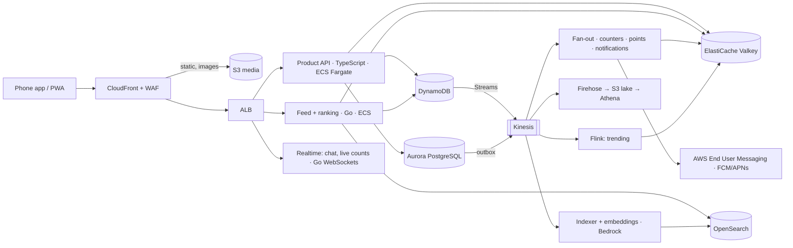

# Nearhood: production architecture

How to run Nearhood for real, from a one-city launch to 10 million posts a day, on AWS. The prototype in this repo is a front end with sample data; this is the plan for everything behind it.

**The short version**

| Layer | Choice |
| --- | --- |
| Source of truth (people, identity, pages, clubs, claims, points totals) | **Amazon Aurora PostgreSQL** with PostGIS and pgvector |
| High-volume writes (posts, replies, votes, check-ins, going, notifications, chat) | **Amazon DynamoDB**, tables designed per access pattern |
| Feeds, counters, leaderboards, sessions, rate limits | **Amazon ElastiCache for Valkey** (Redis-compatible), cluster mode |
| Search: keyword + semantic + geo in one query | **Amazon OpenSearch Service** (BM25 + k-NN hybrid, geo filters) |
| Embeddings and "Nearhood says" | **Amazon Bedrock** (multilingual embeddings; a Claude model for summaries) |
| Events between services | **Amazon Kinesis Data Streams** (or MSK if the team knows Kafka) |
| Media | **S3 + CloudFront**, resized at the edge |
| Compute | **ECS on Fargate (Graviton)** behind ALB; Lambda for light consumers |
| Languages | **TypeScript** (product API), **Go** (feed, ranking, counters, realtime), **Python** (ML) |
| Region | **ap-south-1 Mumbai**, disaster recovery in **ap-south-2 Hyderabad** |

Don't build all of it on day one. Launch on Phase A (below) and move pieces to Phase B when the numbers say so. The keys and IDs are chosen now so that move needs no data rewrite.

---

## 1. What the load looks like at 10 million posts a day

Back-of-envelope, so every choice below has a reason.

| Thing | Per day | Average per second | Peak (×8) |
| --- | --- | --- | --- |
| Posts and check-ins | 10 M | ~115 | ~1,000 |
| Replies | ~40 M | ~460 | ~4,000 |
| Votes (up/down, interested, going) | ~250 M | ~2,900 | ~25,000 |
| Feed opens (≈20 M daily users × 10) | ~200 M | ~2,300 | ~20,000 |
| Post reads (hydrating feeds, ~20 per open) | ~4 B | ~46,000 | ~370,000 |
| Searches and Ask | ~30 M | ~350 | ~3,000 |

- Text is small: a post with its metadata is 1–2 KB, about 20 GB a day.
- Photos are big: if 30% of posts have one at ~400 KB after compression, that's roughly 1.2 TB a day. They go to S3, never into a database.
- **The hard parts are not posts.** They're votes and counters (hot keys on viral posts), feed reads (hundreds of thousands of small reads a second) and fresh ranking. The design aims at those.

---

## 2. Why this mix of databases

**PostgreSQL (Aurora) for things that must be exactly right.** Identity checks, page claims, club membership and admin rights, the points ledger's totals and owner edits all need transactions, constraints and joins. PostGIS answers "pages within 3 km" well, and pgvector covers semantic search in Phase A. Aurora gives replicas, fast failover and storage that grows on its own.

**DynamoDB for high-volume writes.** Posts, replies, votes and check-ins are written millions of times a day, read by key, and never need a join. DynamoDB keeps single-digit-millisecond latency at any volume, scales without anyone touching it, and streams every change (DynamoDB Streams) to the feed, search, counters and notifications. The price is that you design tables around the questions you'll ask, and section 4 does that.

**Why not MongoDB?** MongoDB would work. With **MongoDB Atlas on AWS** you get documents, geo queries, Atlas Search and Atlas Vector Search in one place, which suits a small team that wants one vendor. I'd still pick Postgres + DynamoDB here because:
- identity, claims and clubs are relational and need strict constraints;
- DynamoDB needs no sharding plans or cluster sizing at 250 M writes a day, whereas a sharded Mongo cluster needs careful shard-key and balancing work;
- everything stays AWS-native: IAM, VPC, Streams, backups and India residency.

If the team strongly prefers documents, the Mongo version of this plan is: shard `posts` on `{ cityId: 1, h3r7: 1, _id: "hashed" }`, keep votes in their own collection sharded by voter, and use Atlas Search for text and vectors. Everything else here still applies.

**Why not put everything in Postgres?** You can, up to a point. Phase A does. The limit is not post inserts (Aurora handles thousands a second). It is vote counters: `UPDATE posts SET upvotes = upvotes + 1` on a viral post makes every voter queue on one row. Aurora PostgreSQL **Limitless Database** (sharded Postgres) is an option if you want SQL everywhere; check it's available in Mumbai and how mature it is when you decide.

**Qdrant, OpenSearch or pgvector for semantic search?**
- **pgvector** (Phase A): no extra system, and fine for a few million vectors.
- **OpenSearch** (Phase B): one query can mix keyword (BM25), meaning (k-NN), distance ("within 3 km") and filters (language, freshness, entity type). That hybrid is exactly what "quiet café with wifi near me" needs.
- **Qdrant**: excellent and very fast for pure vector search with payload filters (it filters on geo and fields during the search). Add it later for **recommendation retrieval** if you pass ~100 M+ vectors or need <10 ms nearest-neighbour lookups under heavy filtering. Run it on EKS or Qdrant's managed cloud. Search stays in OpenSearch.

---

## 3. IDs, geography and hashing

**IDs: 64-bit, time-sortable ("Snowflake").**
- Layout: 41 bits of milliseconds since a Nearhood epoch, 10 bits of worker id, 12 bits of sequence. That's 4,096 ids per millisecond per worker, good for ~69 years.
- They sort by time, so "newest first" needs no extra column.
- They fit in a Redis sorted-set member and a Postgres `bigint`.
- They're made in the app with no central counter. Worker ids are leased from a small DynamoDB table when a task starts.
- Applies to posts, replies, check-ins, events, messages and notifications. People, pages and clubs also get a public slug (`brew-lab`).

**Geography: H3 cells** (Uber's hexagonal grid), stored on every page, post and check-in at three resolutions:
- res 9 (~0.1 km²): a street; for pages and check-ins
- res 7 (~5 km²): a neighbourhood; the key for area feeds and "near you"
- res 5 (~250 km²): the city region; for city boards and trending

"Near me" is the user's res-7 cell plus its neighbours (a `gridDisk` of 1–2 rings). That's a handful of exact-match keys instead of a radius scan, which suits both DynamoDB and Redis. PostGIS keeps the exact point for distances and the map.

**Hashing, where it matters:**
- **DynamoDB** hashes each partition key to a partition. Each partition gives ~3,000 reads and ~1,000 writes a second. Keys must have many distinct values, and hot ones get spread (below).
- **Valkey/Redis cluster** maps keys to 16,384 hash slots (CRC16). Wrap the user id in braces, `tl:{u123}`, `seen:{u123}`, so one person's keys share a slot and multi-key commands work.
- **Kinesis** hashes the partition key to a shard. Use the post id for post events (one post's votes stay in order) and the user id for user events.
- **Sharded counters**: a counter key that's too hot gets a suffix `#0`–`#15` chosen by `hash(voterId) % 16`. Reads sum the 16; a background job folds them together.

---

## 4. Data model

### 4.1 Aurora PostgreSQL: cluster `nearhood-core`, database `nearhood`

Schemas, tables and the keys that matter:

```
identity.users            id bigint PK, phone_hash, display_name, handle UNIQUE, home_h3r7, created_at
identity.checks           user_id PK/FK, phone_ok, govid_ok, address_ok, vouches, updated_at
identity.work             user_id PK/FK, title, org, proof (work_email | licence | linkedin), verified_at
places.pages              id bigint PK, slug UNIQUE, name, kind, category, city_id, location geography(Point),
                          h3r9, h3r7, public_place bool, added_by, status (spotted | live | closed), created_at
                          -- GiST(location), btree(city_id, h3r7), partitioned LIST(city_id)
places.page_owners        page_id, user_id, role (owner | partner | manager), since       PK(page_id, user_id)
places.claims             id, page_id, user_id, role, proof_kind, doc_s3_key, phone_ok, status, reviewed_by
places.page_history       id, page_id, actor_id, what, before jsonb, after jsonb, at     -- public, append-only
places.confirmations      page_id, user_id, at                                          PK(page_id, user_id)
clubs.clubs               id, slug, name, kind, city_id, h3r7, privacy, created_by, created_at
clubs.members             club_id, user_id, role (admin | member), joined_at            PK(club_id, user_id)
clubs.meetups / group_buys id, club_id, host_id, title, when, where_page_id, target, ends_at
events.events             id, host_kind, host_id, venue_page_id, title, starts_at, price, link_url, h3r7
civic.reports             id, category, h3r9, status, reporter_id, created_at, fixed_confirmed_at
rewards.totals            user_id, scope (city | h3r5 | club:<id> | topic:<t>), period (all | yyyymm), points
                          PK(user_id, scope, period)     -- written in batches by the points consumer
rewards.levels            user_id PK, level, held_by (missing check), updated_at
```

- Partition the big, growing tables by time (`page_history`, `claims` history) or by city (`pages`).
- Small, hot reference data (levels, page owners) is cached in Valkey.
- Every write that others must hear about also writes a row to an **outbox** table in the same transaction. A relay publishes it to Kinesis (or capture changes with AWS DMS). Nothing is lost if a publish fails.

### 4.2 DynamoDB tables (prefix `nh-`)

Partition key (PK) and sort key (SK) per table, with the question each answers:

| Table | PK | SK | Answers |
| --- | --- | --- | --- |
| `nh-posts` | `POST#{postId}` | `META` | open a post (also holds `authorId, clubId, h3r7, topic, text, media[], createdAt`) |
| GSI `byAuthor` | `AUTHOR#{userId}` | `{postId}` | a profile's posts, newest first |
| GSI `byClub` | `CLUB#{clubId}#{n}` | `{postId}` | a club's posts; `n` = 0 normally, 0–7 for clubs over ~50k members |
| GSI `byCellDay` | `CELL#{h3r7}#{yyyymmdd}` | `{postId}` | a neighbourhood's posts for a day (the day keeps partitions bounded) |
| `nh-replies` | `POST#{postId}` | `{rootReplyId}#{replyId}` | a whole thread in order; one root's sub-thread is a contiguous range |
| `nh-votes` | `USER#{userId}` | `{targetType}#{targetId}` | "did I vote on these 20 posts?" (one BatchGet); one vote per person per thing (conditional put) |
| `nh-checkins` | `USER#{userId}` | `{checkinId}` | someone's check-ins |
| GSI `byPage` | `PAGE#{pageId}` | `{checkinId}` | a page's reviews |
| `nh-plans` | `USER#{userId}` | `EVENT#{eventId}` | your Interested / Going / ticket / company |
| GSI `byEvent` | `EVENT#{eventId}#{n}` | `{userId}` | who's going (spread over `n` = hash(user) % 8 for big events) |
| `nh-follows` | `USER#{a}` | `FOLLOWS#{b}` | who I follow (a reverse item `FOLLOWERS#` serves who follows me) |
| `nh-notifications` | `USER#{userId}` | `{notifId}` | the Updates list; TTL 90 days |
| `nh-chat` | `CONV#{convId}` | `{messageId}` | a conversation; a `USER#{id}` inbox item per conversation |
| `nh-ledger` | `USER#{userId}` | `{eventId}` | every point earned or lost, append-only; source for `rewards.totals` |
| `nh-counters` | `{targetType}#{targetId}#{shard}` | `C` | votes, replies, going, interested; shard 0 unless hot |

Notes:
- **Votes are keyed by the voter, not the post.** A viral post's 50,000 votes land on 50,000 different keys, so there's no hot partition, and no "who voted" list (that's private). Totals come from the stream into `nh-counters` and Valkey.
- **Counts are never computed by scanning.** The stream consumer increments counters, batching per second for hot posts.
- **Items stay small**: text and metadata only. Media are S3 keys, rendered at the edge.
- On-demand capacity to start; provisioned with auto scaling once traffic is steady, which is cheaper. Point-in-time recovery on. Global tables to Hyderabad for disaster recovery.

### 4.3 Valkey / Redis keys (ElastiCache, cluster mode, Multi-AZ)

```
tl:{u}               ZSET  a person's home timeline: postId → score, last ~800 ids
club:{c}             ZSET  a club's recent posts (for clubs too big to fan out)
cell:{h3r7}:hot      ZSET  a neighbourhood's trending posts and events, rescored every minute
city:{id}:events     ZSET  trending events this week
post:{id}            HASH  hot post cache for hydrating feeds (TTL 10 min)
cnt:{type}:{id}      HASH  up, down, replies, going, interested (write-behind to DynamoDB)
fol:{u}              SET   who u follows (for "friends going" via SINTER)
going:{event}        SET   who's going (privacy-filtered)
lb:{scope}:{period}  ZSET  City heroes boards: city, h3r5, club, topic; month and all-time
seen:{u}             Bloom posts already shown, so the feed doesn't repeat
rl:{u}:{action}      token bucket for rate limits (posting, voting, OTP)
ask:{hash(q)}:{h3r5} STRING cached "Nearhood says" answer, TTL 10 min
```

---

## 5. The feed: how it stays fast and fresh

Target: **Home feed p99 under 150 ms**, server time.

**1. Writing a post**
1. The API writes to DynamoDB.
2. The stream (or outbox) puts a `post.created` event on Kinesis, keyed by post id.
3. Consumers handle it:
   - **Fan-out** (Go): pushes the post id into followers' `tl:{u}` sorted sets.
   - **Club**: adds it to `club:{c}`.
   - **Area**: adds it to `cell:{h3r7}:hot` with an initial score.
   - **Search**: indexes it in OpenSearch with its embedding (via Bedrock).
   - **Moderation**: checks text and image.

**2. Hybrid fan-out**
- Normal people (under ~10k followers): fan out on write, a few thousand Valkey `ZADD`s.
- Big accounts, pages and big clubs: no fan-out. Their posts are pulled at read time and merged. This avoids the "celebrity posts, 2 million writes" problem.

**3. Reading the feed** (Go feed service)
1. Gather about 500 candidates from:
   - `tl:{u}`: friends
   - the clubs you're in
   - your cell and its neighbours, from `cell:*:hot`
   - city trending events
   - people you follow with big audiences, pulled
   - "Help comes back": questions from people who helped you
   - *(Phase B)* nearest neighbours of your interest vector, from OpenSearch or Qdrant
2. Hydrate them in one pipelined `HMGET` from `post:{id}`, falling back to DynamoDB `BatchGetItem` for misses (DAX in front if the read volume justifies it).
3. Rank in process. Phase A uses the formula the prototype already has: freshness, votes, helpful marks, the author's level, how close it is, friend affinity, topic match. Phase B uses a small gradient-boosted model (LightGBM/XGBoost) exported to ONNX and run inside the Go service, with features from Valkey. Nothing waits on a network model call.
4. Re-rank for variety: not five food posts in a row, keep a mix of friends, area and clubs, and enforce safety.
5. Remember what was shown in `seen:{u}`, then return 20 items and a cursor.

**Trending**
- Managed Service for Apache Flink reads the vote, reply and going streams and computes **velocity** (pull per minute, decayed).
- Every 60 s it rewrites `cell:{h3r7}:hot` and `city:{id}:events`.
- It's the same idea as the prototype's trending score, computed continuously.

**Counters**
- Votes go to `nh-votes` (one per person, idempotent).
- The stream increments `cnt:*` in Valkey at once, so people see it, and writes to `nh-counters` in batches (sharded for hot posts).
- The UI shows the Valkey number.

---

## 6. Search, semantic search and "Nearhood says"

**Indices (OpenSearch)**
- `posts-YYYY.MM.DD`: daily, rolled over; 30 days hot, then UltraWarm, then deleted after a year.
- `pages`, `people`, `clubs`, `events`.

Each document holds:
- text, with ICU analysers for **English, Gujarati and Hindi**
- an H3 cell and a geo point
- entity type, topic and freshness
- a **multilingual embedding**: Bedrock's Titan Text Embeddings V2 at 512 dimensions, or Cohere Embed Multilingual; pick by a quick test on Gujarati and Hinglish.

**Query**
- One hybrid search: BM25 + k-NN, combined with a normalisation search pipeline, filtered by `geo_distance` and city, then boosted by helpfulness and freshness.
- "Quiet café with wifi" finds The Quiet Cup even if nobody wrote those exact words.

**Keeping vectors affordable**
- Quantise to 8-bit (or binary with rescoring).
- Keep vectors for 90 days of posts, plus all pages, clubs and events. Older posts are searchable by keyword only.

**"Nearhood says" (Ask)**
1. Embed the question.
2. Run a hybrid search over posts, replies and pages near the person.
3. Have a Claude model on Bedrock write a short answer that **only uses what it was given**, with citations back to the replies.
4. Cache by (normalised question, area) for 10 minutes. Popular questions are pre-answered.
5. Show where it came from, as the app already does.

Check Bedrock model availability in Mumbai. If you use cross-region inference, record it against the data-residency rules (section 9).

**Other uses of embeddings**
- **Duplicate pages**: "Brew Lab" vs "Brewlab CG Road", using nearest neighbours plus distance.
- **Spam and promotion detection.**
- **Recommendations**: an interest vector per person (a moving average of what they engage with), stored in Valkey.

---

## 7. Media

1. The app asks the API for a **pre-signed S3 upload URL** and uploads the photo straight to S3. The API never handles image bytes.
2. An S3 event triggers a Lambda that:
   - strips location metadata
   - checks the image (Amazon Rekognition moderation)
   - writes the size variants or marks it for on-the-fly resizing
3. **CloudFront** serves images resized at the edge (AWS's Serverless Image Handler / Dynamic Image Transformation solution), in AVIF/WebP, cached for a long time.
4. Video later: S3 + AWS Elemental MediaConvert to HLS, served through CloudFront.
5. Buckets: `nh-media-aps1` (Intelligent-Tiering), `nh-lake-aps1` (analytics), `nh-docs-aps1` (claim documents: private, KMS-encrypted, deleted after review, never public).

---

## 8. Services and AWS building blocks



| Need | Service |
| --- | --- |
| Front door, caching, DDoS | CloudFront, AWS WAF, Shield Standard |
| API compute | ECS on Fargate, Graviton (arm64), behind an Application Load Balancer; target-tracking auto scaling |
| Light event consumers | Lambda (SQS for retries and dead letters) |
| Event stream | Kinesis Data Streams on-demand (MSK Serverless if you prefer Kafka) |
| Stream processing | Managed Service for Apache Flink |
| Sign-in | Cognito user pools with a custom phone-OTP flow (or a small auth service); DigiLocker through its partner API |
| SMS OTP and push | AWS End User Messaging (SMS), FCM/APNs for push. Indian SMS needs TRAI DLT registration of templates |
| Realtime | WebSockets on ECS (Go) with Valkey pub/sub; API Gateway WebSockets is fine early on |
| Background jobs | EventBridge Scheduler + ECS tasks (season resets, digests, re-indexing) |
| Secrets and keys | Secrets Manager, KMS |
| Observability | OpenTelemetry → CloudWatch, X-Ray, Amazon Managed Prometheus and Grafana |
| Analytics | Firehose → S3 (Parquet) → Athena; Redshift Serverless when needed; QuickSight dashboards |
| ML | SageMaker for training the ranking model; Bedrock for embeddings and summaries |
| Security posture | GuardDuty, Security Hub, private subnets, VPC endpoints for S3 and DynamoDB |

**Languages**
- **TypeScript** (Node 22, Fastify or NestJS) for the product API. It shares types and validation (zod) with the React app, and the team already writes React.
- **Go** for the hot paths: feed, ranking, fan-out, counters and WebSockets. It gives low latency and memory, and handles concurrency well.
- **Python** for ML pipelines.
- **Phone apps**: **React Native (Expo)**, reusing the prototype's logic and design tokens.
- **API style**: REST/JSON (or tRPC between app and API), cursor-based pagination everywhere, and ETags on public GETs.

---

## 9. Caching, speed and reliability

**Caching, from the screen inwards**
1. On the device: the PWA's offline cache plus React Query, so screens paint from cache and refresh quietly.
2. CloudFront: images and static files for a year (hashed names). Public pages and events for 30–60 s with stale-while-revalidate. Personal endpoints are never cached at the edge.
3. Valkey: timelines, hot posts, counters, boards, sessions.
4. DAX in front of DynamoDB, only if hydration misses get expensive.
5. Aurora read replicas for profile, page and club reads.

**Speed budget**
- Feed p99: 150 ms server.
- A page or event opening: under 100 ms server, then the edge-cached photo.
- Search and Ask: 300 ms. Ask's model answer streams in.

**Reliability**
- Everything Multi-AZ in Mumbai.
- DynamoDB global tables and an Aurora Global Database replica in Hyderabad.
- S3 cross-region replication.
- Recovery targets: RPO under 1 minute, RTO under 1 hour.

**Data residency and privacy (India's DPDP Act 2023)**
- Personal data stays in the Mumbai and Hyderabad regions.
- Phone numbers are stored hashed for lookup and encrypted for messaging.
- ID checks keep only the result, never the document number (as the app promises).
- Claim documents are deleted after review.
- Account deletion cascades through the stream.

**Abuse and fairness**
- Rate limits per action in Valkey.
- Vote-ring detection, a nightly graph job plus streaming heuristics, as the helpful-points rules require.
- Only verified votes count toward points.
- Moderation queues for guides.

---

## 10. Phases: build only what the numbers need

| Phase | Scale | What runs |
| --- | --- | --- |
| **A. Launch** (one city) | up to ~100k posts/day | One TypeScript service (a modular monolith) on ECS. Aurora PostgreSQL holds everything (posts partitioned by month, PostGIS, pgvector). Valkey for feeds and counters. S3 + CloudFront. SQS for jobs. Feeds computed on read with the prototype's ranking. |
| **B. Several cities** | ~100k–2M/day | Posts, replies, votes, check-ins and plans move to DynamoDB, with the same IDs and H3 keys, so it's a copy, not a redesign. Kinesis + consumers. OpenSearch hybrid search. Fan-out on write. The Go feed service is split out. |
| **C. National** | 2M–10M+/day | Hybrid fan-out tuned for big accounts. Flink trending. A learned ranking model. Qdrant (or OpenSearch k-NN) for interest-based retrieval. Sharded hot counters. DAX if needed. DR region active-passive. |

Move to the next phase when these trigger:
- Aurora writer CPU stays above 60%.
- Vote-row lock waits show up.
- Feed p99 goes over 150 ms.
- pgvector recall or latency stops being good enough.

Until then, the simpler setup is cheaper and faster to change.

**Decisions to make now (cheap now, expensive later)**
1. **64-bit Snowflake ids** for everything people create.
2. **H3 cells at res 9, 7 and 5** on every page, post and check-in.
3. Votes and plans **keyed by the person**, counts kept separately.
4. An **outbox/event** for every write others care about.
5. **Multilingual** text handling (English, Gujarati, Hindi) from day one.
